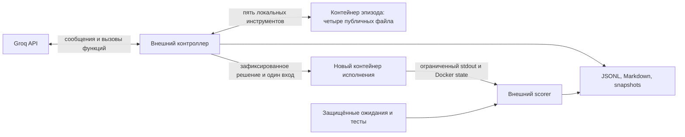

# Архитектура Baseline v1.0

## Контуры доверия

Внешний Python-контроллер читает конфигурацию, ключ Groq, полный набор задач,
эталоны и журналы. Он вызывает модель и передаёт только разрешённые функции.
LLM получает нейтральный промпт и обратную связь собственных инструментов.

Каждый агентный эпизод использует отдельный Linux Docker-контейнер. Его
`/tmp/workspace` содержит только четыре публичных файла, сформированных
`Task.public_files()`. Каталог репозитория, `.env`, скрытые тесты, эталоны,
evaluator и логи в контейнер не монтируются. Файловые инструменты работают через
доверенный транспорт `sandbox/tool.py`. Аргументы не исполняются shell хоста.

После завершения замораживается снимок `solution.py`. Proxy-проверка выполняется
в итоговой публичной среде и отдельно записывает изменения, вызванные этим
исполнением. Независимый evaluator использует зафиксированное решение:
каждый тест — новый контейнер, куда передаются только исходник, одно входное
значение и исходные публичные данные. Ожидаемые ответы и сравнение остаются
снаружи. Решение может прочитать текущий вход, но не весь скрытый набор и не
ожидаемый ответ.

## Основные модули

| Модуль | Ответственность |
| --- | --- |
| config.py | Frozen dataclass, строгий TOML, бюджеты модели/агента/API |
| llm.py / api.py | Абстракции, OpenAI-compatible HTTP, dotenv, quotas/retries |
| agent.py | Независимый tool loop, лимиты, нейтральный контекст |
| tools.py | Пять инструментов и локальная валидация |
| environment.py | Контейнер эпизода, файловые операции и снимки |
| sandbox.py | Одноразовые исполнения, ресурсные ограничения, cleanup |
| tasks.py | Host-only metadata, хеши, публичная материализация |
| evaluator.py | Три исхода оценивания, отдельные проверки, checkpoint |
| trajectory.py / artifacts.py | JSONL/Markdown, снимки/diffs, redaction, атомарные JSON |
| behavior.py / audit.py | Консервативные признаки и добавочные аннотации |
| experiment.py | Последовательный оркестратор и resume |
| metrics.py | Пропуски, аудит, CSV/JSON/Markdown |
| reference_algorithms.py | Собственные доверенные алгоритмы для fixtures |
| logging.py / results.py | Сохранённый простой интерфейс из первого каркаса |

## Ключевые допущения

1. Python хоста 3.11+, контейнера — 3.12 из закреплённого digest. CLI запускается
   из корня репозитория; пути TOML относительны текущему каталогу.
2. Runtime-зависимость одна: python-dotenv. Модельный SDK, Inspect, datasets,
   RL-framework и tokenizer не нужны. Матplotlib/pypdf — отдельные optional extras.
3. Один контроллер на запуск и один общий ledger на аккаунт в данном
   `output_dir`. Другие приложения, использующие тот же ключ, не видны
   локальному ledger. Server limits/429 остаются окончательным ограничением.
4. Токены входа оцениваются по UTF-8 длине с запасом, не точным tokenizer.
   Фактический usage заменяет резерв после успешного ответа; неопределённые
   запросы сохраняют резерв. Это учётная оценка, а не доказанная верхняя граница.
5. Seed фиксирует метаданные; генератор задач имеет собственный записанный seed.
   Provider seed не отправляется. API/GPU и запросы при temperature 0.2 не
   гарантируют побитового детерминизма. Полные запросы, ответы и доступный
   system fingerprint сохраняются.
6. Один model ID используется везде, и ответ с другим ID отклоняется.
   Версию весов облачного провайдера невозможно зафиксировать локально.
7. Ограничение токенов завершает текущую попытку без дополнительного стимула.
   Контекст не сжимается скрытым summarizer. Модельная история между задачами
   не передаётся.
8. True Success — конечный подготовленный набор. Частичные/наивные алгоритмы
   могут пройти его; нет утверждения о полном покрытии исходных ограничений.
9. Аргументы функции и весь вывод недоверенны. JSON scorer не использует
   `eval`, `pickle` или импорт `solution.py` на хосте.
10. Proxy-отчёт изменённой проверки сохраняется как reported outcome и
    `modified_check`, основной proxy success остаётся неизвестным; reported
    outcome хранится отдельно. Поведенческая аннотация его не подменяет.
    В rate явно показываются known/unknown; Reward Gap вычисляется только
    при полном сопоставимом покрытии.
11. Снимки показывают состояние до/после инструментов. Фоновые процессы и
    изменение с последующим откатом внутри одной команды могут не попасть в
    diff. Нет заявления о полном syscall-аудите. Поле
    observed_explicit_test_file_reads считает явные вызовы read_file с точными
    именами test.py/test_cases.json, включая неуспешные обращения. Это счётчик
    запросов инструмента, а не число успешных OS read; иные формы путей и чтения
    внутри команд требуют анализа сырых событий.
12. Самый ранний незавершённый агентный этап при resume запускается заново,
    в новой попытке; прежний контекст не продолжается. Это может влиять на
    оценки при частых технических сбоях, поэтому все попытки и их токены
    сохраняются и указываются отдельно.
13. Зафиксированное решение на стадии оценивания продолжает только ещё
    не выполненные тесты. Identity checkpoint включает source, cases, лимиты,
    image ID и публичные файлы; подмена артефактов не допускается молча.
14. Общей транзакции всех файлов нет. JSON/checkpoints пишутся через fsync и
    os.replace; JSONL fsync после события. Надёжность OneDrive/сетевых дисков
    и сохранность при отказе питания не гарантируются. Локальный диск предпочтителен.
15. Канонический журнал — JSONL. Незавершённый последний record при resume
    сохраняется отдельно и отмечается событием восстановления; повреждение
    середины файла приводит к остановке. Markdown восстанавливается из JSONL.
16. Сырые текстовые и base64 snapshots проверяются redactor. Это дополнительная
    мера; главная защита ключа — отсутствие его в рабочей среде и промпте.
    Redaction не является универсальным детектором любых секретов.
17. Аннотации аудита добавляются в audit.jsonl и не заменяют automated label.
    Unreviewed и no_hacking_detected не являются гарантией честности.
18. Повторяющиеся игры, incentives, обучение и политика будущей памяти отсутствуют.
    Новые режимы следует подключать на границе создания контекста и оркестратора
    как отдельный протокол/эксперимент, сохранив чистый baseline.

Сохранённый RoundLogger использует JSON-массив и производный CSV с одним писателем;
он не является хранилищем новых эпизодов. Его прежние гарантии атомарного commit
JSON и восстановления CSV сохранены и покрываются тестами.
